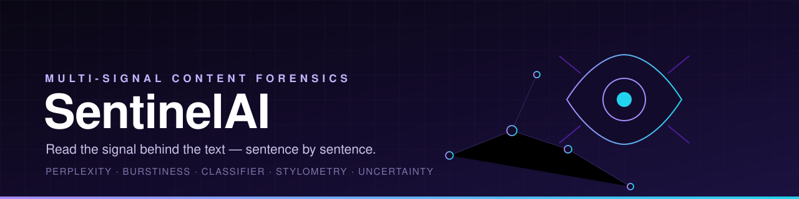
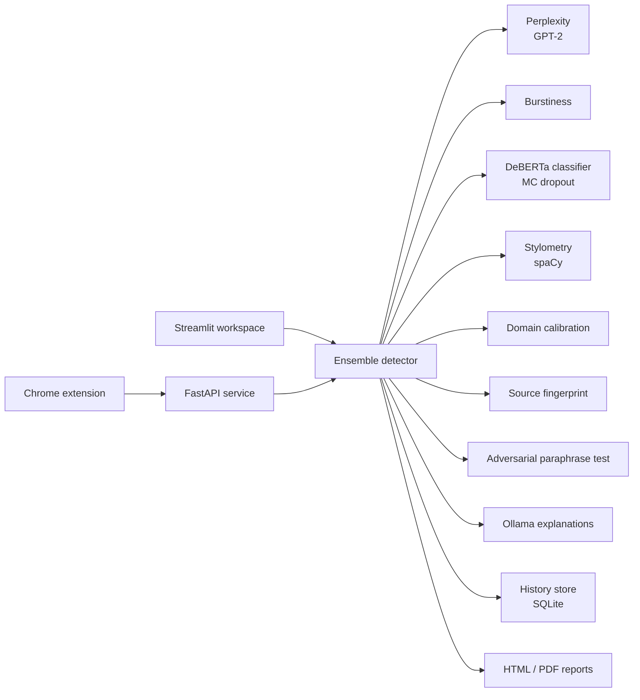

<div align="center">
  
</div>

<div align="center">

**Read the signal behind the text — sentence by sentence.**

[](https://github.com/SyedShah29/SentinelAI/actions/workflows/ci.yml)
[](LICENSE)
[](https://www.python.org/)
[](https://streamlit.io/)
[](https://fastapi.tiangolo.com/)

Designed and built by **Syed Hasaan Shah**.

</div>

---

SentinelAI is an AI-content detection platform built around an ensemble of
independent signals rather than a single classifier. It scores perplexity,
burstiness, neural classification, stylometry, and domain-calibrated priors,
then explains the verdict at sentence and token level. The same engine powers a
Streamlit workspace, a documented REST API, and a Chrome extension for checking
selected text on any page.

```text
text → preprocess → signal engines → weighted ensemble → verdict + evidence
```

---

## Why SentinelAI

- **Multiple independent signals** — statistical, neural, and stylistic evidence
  are combined, so no single model decides alone.
- **Sentence-level evidence** — every sentence gets a probability, a perplexity
  score, and word-level attribution.
- **Confidence, not just a label** — Monte Carlo dropout produces an uncertainty
  band around the score.
- **Domain-aware** — thresholds adapt to the detected domain instead of using one
  global cutoff.
- **Explainable output** — connects flagged sentences to the phrases and tokens
  that drove the decision.
- **Three surfaces, one engine** — interactive Streamlit app, REST API, and a
  browser extension.

---

## Features

### Detection engine
- `detector/preprocessor.py` — sentence segmentation, Unicode and homoglyph
  normalization, language checks.
- `detector/perplexity.py` — GPT-2 perplexity with domain-aware thresholds and
  sliding-window scoring.
- `detector/burstiness.py` — variation in sentence length and rhythm.
- `detector/classifier.py` — DeBERTa-based classifier with Monte Carlo dropout
  uncertainty and optional fine-tuned weights.
- `detector/stylometry.py` — connective density, passive voice, sentence length,
  and other style features via spaCy.
- `detector/domain_classifier.py` — domain detection (academic, news, code,
  casual, and more) used to calibrate thresholds.
- `detector/fingerprint.py` — source-model fingerprinting across ChatGPT, GPT-4,
  Gemini, Claude, Llama, Mistral, and DeepSeek.
- `detector/ensemble.py` — weighted fusion, confidence tiers, and the final
  verdict.
- `detector/token_attribution.py` — per-word contributions behind a sentence
  score.
- `detector/adversarial.py` — paraphrase-based evasion testing with a measured
  risk level.
- `detector/explainer.py` — local Ollama rewrite suggestions for the most
  AI-flagged sentences.

### Streamlit workspace
- Paste text or upload TXT, PDF, or DOCX.
- Verdict banner, confidence badge, domain pill, and component breakdown.
- Overall gauge with an uncertainty band, sentence highlighting, and token
  indicators.
- Fingerprint distribution, stylometry detail, adversarial robustness panel, and
  export to HTML or PDF.
- History dashboard with verdict distribution, score histogram, daily volume,
  drift, domain breakdown, and detected source models (`store/history.py`).

### REST API
- FastAPI service with API-key authentication and OpenAPI docs at `/docs`.
- Routes: `POST /api/v1/analyze`, `POST /api/v1/analyze/batch`,
  `POST /api/v1/analyze/file`, `GET /api/v1/health`, `GET /api/v1/info`.
- Batch analysis, file upload, configurable sentence/metadata inclusion, CORS,
  and consistent error envelopes.

### Browser extension
- Manifest-based extension that sends selected text to the local API.
- Context-menu action, popup UI, and inline score display.

### Training pipeline
- `training/prepare_data.py` — dataset assembly and cleaning.
- `training/train_classifier.py` — fine-tune the DeBERTa detector.
- `training/train_fingerprint.py` — multi-LLM fingerprint model.
- `training/train_llm_classifier.py` and `training/evaluate.py` — iterative
  training and evaluation.

---

## Architecture



---

## Tech stack

| Layer | Technology |
| --- | --- |
| Models | PyTorch, Transformers, scikit-learn, spaCy |
| Signals | GPT-2 perplexity, burstiness, stylometry, domain classification |
| UI | Streamlit, Plotly |
| API | FastAPI, Pydantic, Uvicorn |
| Documents | pdfplumber, python-docx |
| Reports | Jinja2, ReportLab |
| Extension | Chrome Manifest + content/background scripts |
| Storage | SQLite history store |

---

## Quick start

```bash
# 1. Install dependencies
py -3.11 -m pip install -r requirements.txt

# 2. Download the spaCy language model
py -3.11 -m spacy download en_core_web_sm

# 3. Launch the workspace
py -3.11 -m streamlit run app.py
```

The Streamlit app opens in your browser. Paste text or upload a document and
run the analysis.

### REST API

```bash
cp .env.example .env         # set API_KEY_1
uvicorn api:app --host 127.0.0.1 --port 8000
```

```bash
curl -X POST http://127.0.0.1:8000/api/v1/analyze \
  -H "X-API-Key: your-key" \
  -H "Content-Type: application/json" \
  -d '{"text": "Your text goes here. Add a few sentences for a stable score."}'
```

### Browser extension

1. Open `chrome://extensions/`.
2. Enable Developer Mode.
3. Choose **Load unpacked** and select `browser_extension/`.
4. Select text on any page, right-click, and choose **Check with SentinelAI**.

The extension expects the REST API on `http://127.0.0.1:8000`.

---

## Training

```bash
python training/prepare_data.py
python training/train_classifier.py
python training/train_fingerprint.py
python training/evaluate.py
```

Model checkpoints and datasets live under `models/` and `data/`, both ignored by
git so the repository stays lean.

---

## Project layout

```text
app.py                  # Streamlit workspace
api.py                  # FastAPI application
api/                    # routes, auth, request/response models, utilities
detector/               # signal engines and ensemble
training/               # dataset prep, training, evaluation
export/                 # HTML/PDF report generation
store/                  # SQLite analysis history
browser_extension/      # Chrome extension
static/                 # API landing page
tests/                  # detector tests
```

---

## Testing

```bash
python -m pytest tests/test_detector.py -v
python tests/smoke_test.py
```

---

## Author

Built end-to-end by **Syed Hasaan Shah**.

---

## License

Released under the [MIT License](LICENSE).
